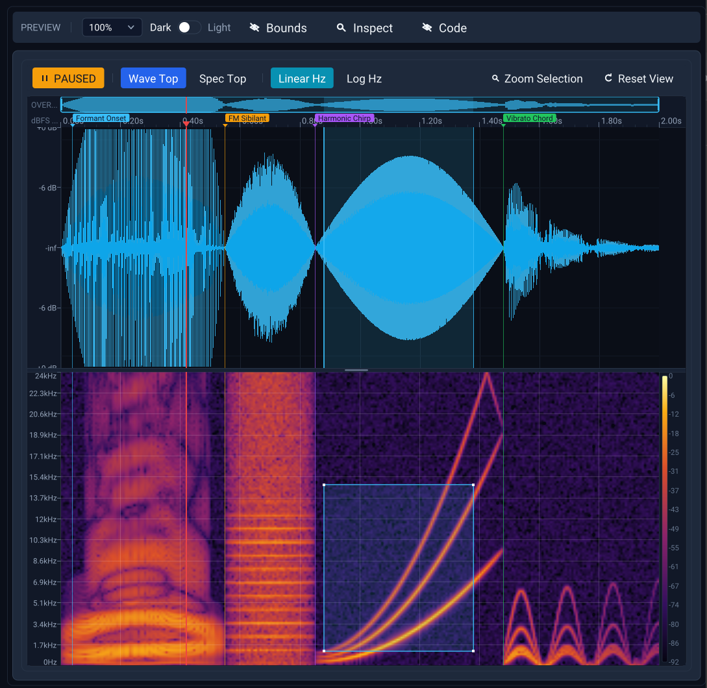
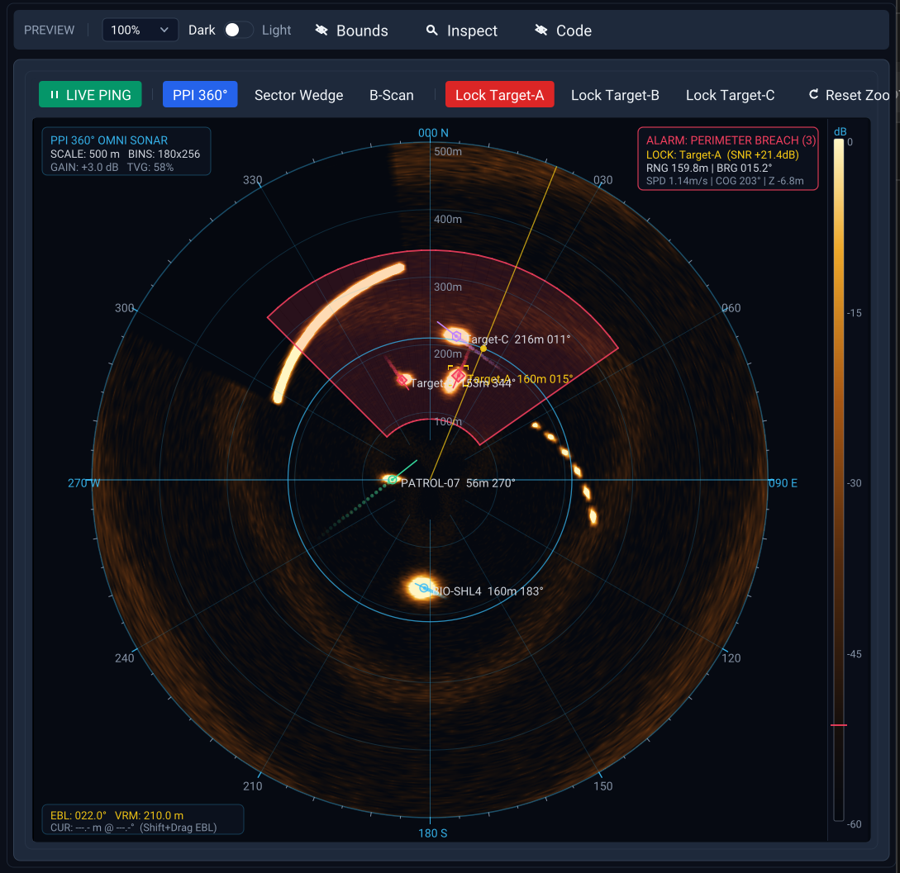
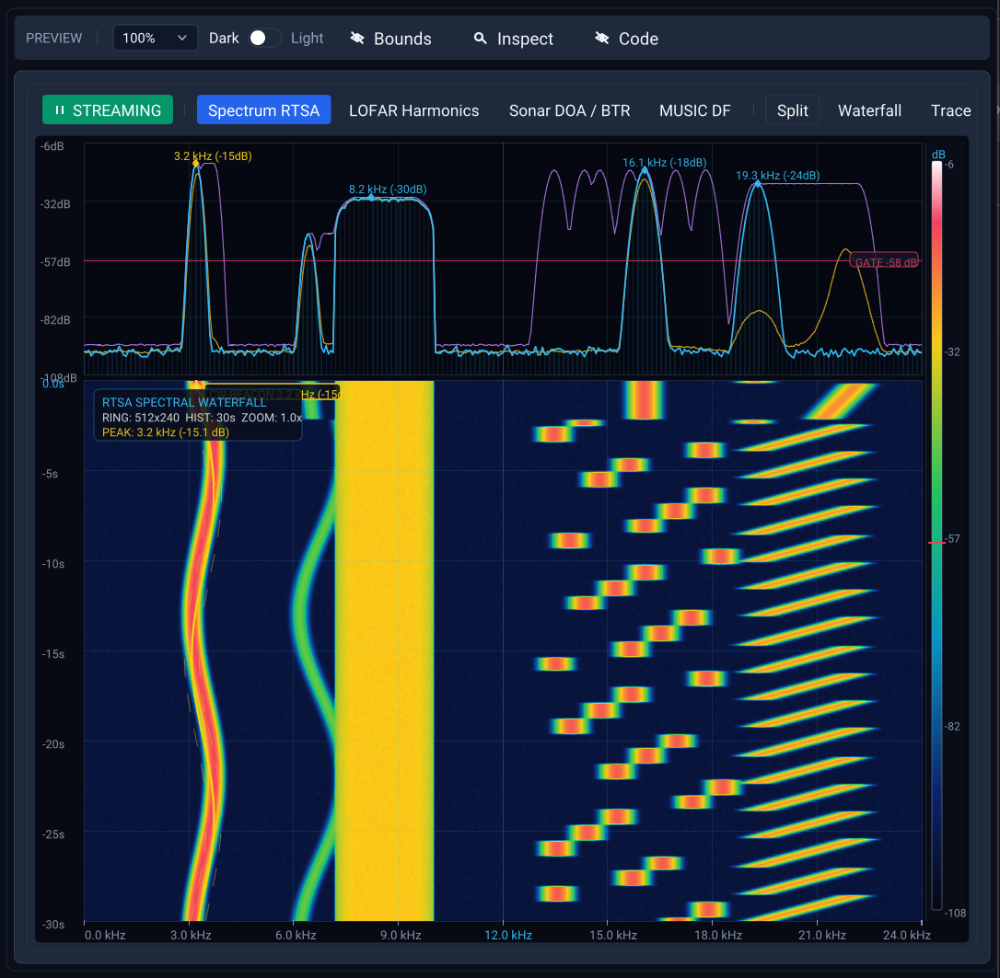

# guikit/signal

Real-time DSP, RF, and Sonar/Radar visualization widgets (`SignalView`, `SonarView`, `WaterfallView`) with hardware OpenGL / WebGL2 GLSL shader underlays and CPU fallbacks for **[GuiKit](https://github.com/guikit/guikit)**.

| **Waveform + STFT Spectrogram (`SignalView`)** | **PPI 360° / Sector / B-Scan (`SonarView`)** |
| :---: | :---: |
|  |  |

| **RTSA / BTR Spectral Waterfall (`WaterfallView`)** |
| :---: |
|  |

## Widgets

- **`guikit::signal::SignalView`**: Synchronized time-domain waveform + STFT spectrogram analyzer with GPU shader rendering, colormap selection, zoom/pan, and harmonic cursor readouts.
- **`guikit::signal::SonarView`**: Polar PPI 360°, Sector Wedge, and B-Scan sonar/radar display with TVG, clutter gating, range rings, bearing lines, and target overlays.
- **`guikit::signal::WaterfallView`**: Hardware circular ring-buffer RTSA / BTR spectrum waterfall with time-axis scrolling, dynamic dB floor/ceiling, and DOA target tracking.

## Quick Usage

```cpp
#include "guikit/guikit.hpp"
#include "guikit/signal.hpp"

guikit::signal::SignalView(ui, signalData, {.height = guikit::SizeMode::Stretch});
guikit::signal::SonarView(ui, sonarData, {.height = guikit::SizeMode::Stretch});
guikit::signal::WaterfallView(ui, waterfallData, {.height = guikit::SizeMode::Stretch});
```

## CMake Integration

```cmake
add_subdirectory(guikit)
add_subdirectory(signal)

target_link_libraries(my_app PRIVATE guikit::guikit guikit::signal)
```

For the unified workspace and full interactive showcase (`guikit_demo`), see **[`guikit/bundle`](https://github.com/guikit/bundle)**.

## License

BSD Zero Clause License (`0BSD`). See [LICENSE](LICENSE) for details.
